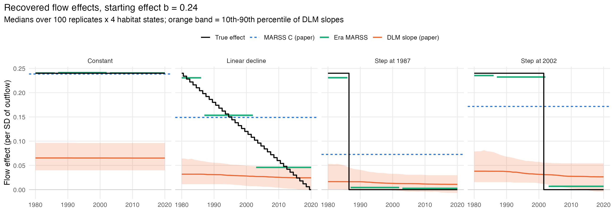
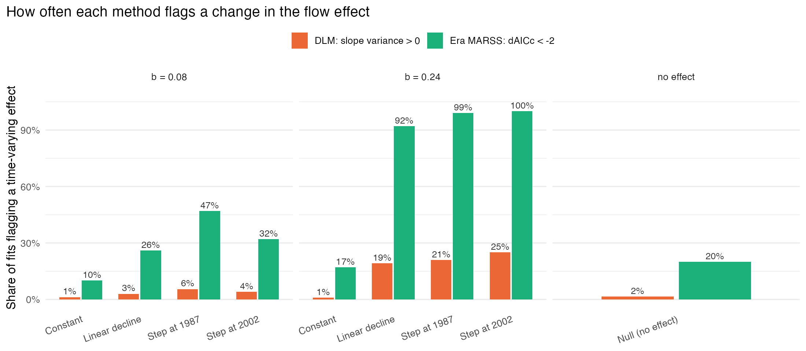
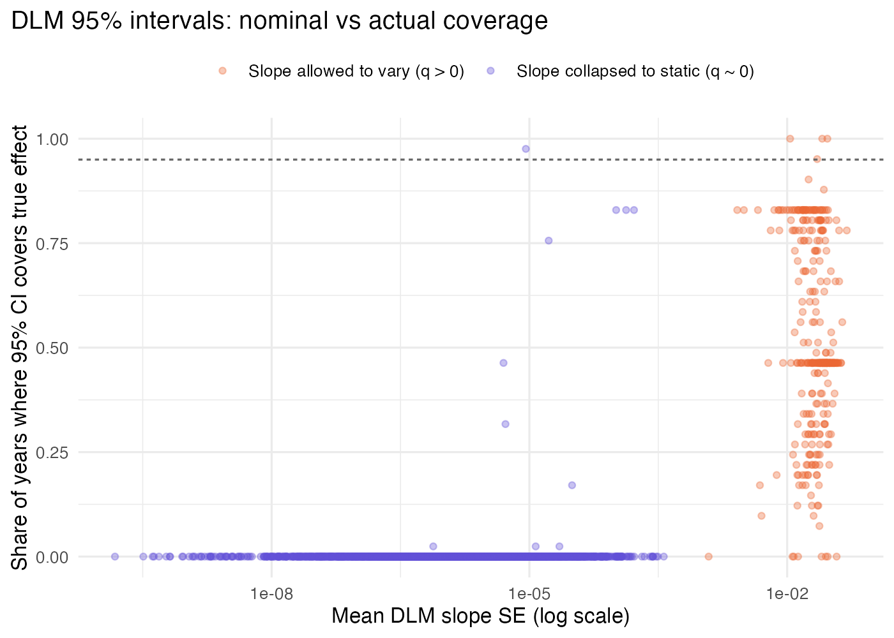
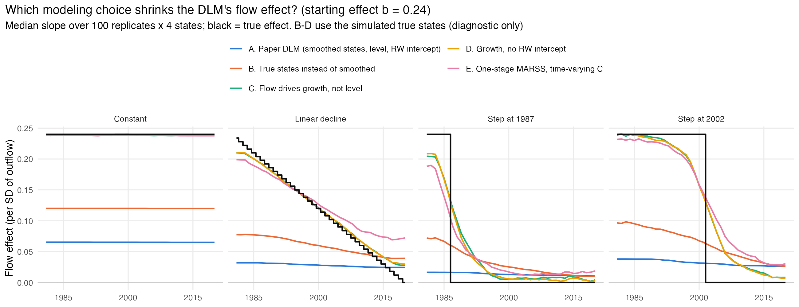
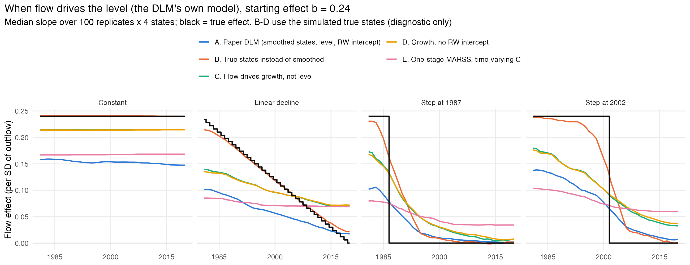
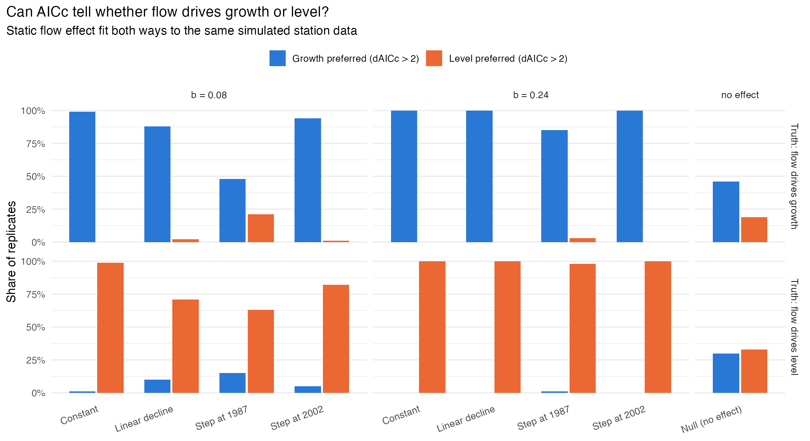
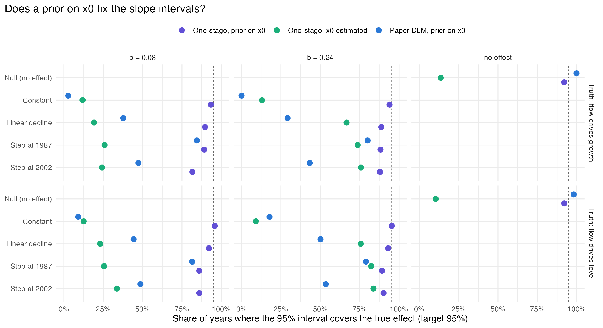
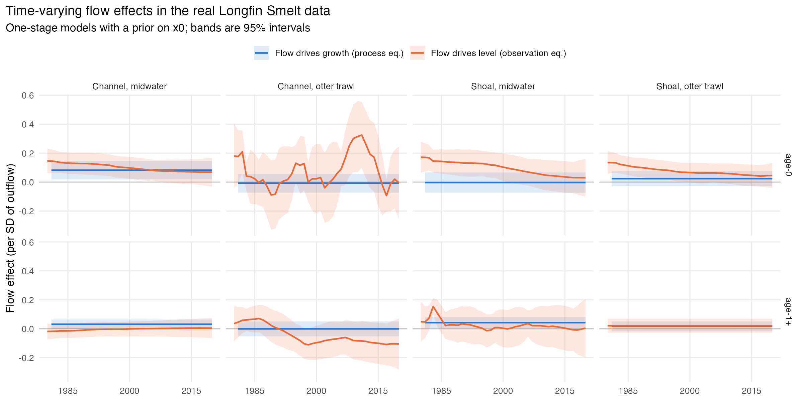

## The question {.smaller}

Saffarinia et al. (2026, *Ecological Applications*) asked whether the effect of Delta outflow on
Longfin Smelt has changed over time.

- **Data:** CDFW Bay Study trawls, 1980–2020; age-0 and age-1+ CPUE at 24 stations (the paper says 25)
- **Two models:**
  - **MARSS** — one *time-averaged* flow effect per habitat
  - **DLM** — a flow effect that can *drift* year to year
- **Headline:** flow effects are positive but *weakening*; the two methods agree only ~30% of the time

. . .

**This talk:** rerun their code, then simulate data where we *know* the true flow effect —
constant, declining, or a step change at 1987 or 2002 — and see what each method recovers.

::: {.notes}
Motivation: time-varying relationships are an appealing idea for management, and the paper is a nice,
fully reproducible example (code on Zenodo, data on Dryad). The question for this group is a methods
one: can these tools actually detect the kind of change they're being used to detect?
:::

## Two models, two assumptions {.smaller}

:::: {.columns}
::: {.column width="50%"}
**MARSS (paper's time-averaged model)**

$$x_t = x_{t-1} + C\,\text{flow}_t + w_t$$
$$y_t = Z x_t + v_t$$

Flow changes the **growth** of log CPUE.
:::
::: {.column width="50%"}
**DLM (paper's time-varying model)**

$$\hat{x}_t = \alpha_t + \beta_t\,\text{flow}_t + v_t$$
$$\alpha_t, \beta_t \text{ random walks}$$

Flow shifts the **level** of log CPUE, fit to the MARSS *smoothed states* $\hat{x}_t$ (two stages).
:::
::::

. . .

> Comparing $C$ with $\beta_t$ compares two different quantities — that turns out to matter a lot.

::: {.notes}
This is the single most important slide for the rest of the talk. The MARSS puts flow in the process
equation; the DLM regresses the level of smoothed states on flow. Same word "flow effect", different
structural assumption.
:::

## The repo

```{.tree}
longfin-flow/
├── original-manifest.csv     md5 of every file the analysis used
├── R/
│   ├── fetch_original.R      get authors' code (Zenodo) + verify data (Dryad)
│   ├── 00_run_original.R     run the authors' scripts unmodified
│   ├── 01_replication_check.R
│   ├── 02_sim_setup.R        build model inputs from the authors' pipeline
│   ├── design.R              scenarios, eras, grid, seeds, thresholds
│   ├── sim_functions.R       simulate → fit → score
│   ├── 03_run_simulation.R   parallel, checkpointed studies
│   ├── 04–08_*.R             summaries, real-data fits, checks
│   └── plot_helpers.R
├── output/results/           compact per-replicate results (committed)
├── output/figures/
├── renv.lock
└── FINDINGS.md
```

::: {.notes}
Numbered scripts run in order. Everything the summary scripts need is committed, so the tables and
figures rebuild in minutes; the simulations themselves take about 8.6 hours on 7 cores.
:::

# Part 1: Reproducibility

## Point to the source, verify the copy {.smaller}

- Authors' **code** (Zenodo, CC-BY) and **data** (Dryad, CC0) are *not* redistributed: `original/` is gitignored
- `original-manifest.csv` records the md5 of every file used; Zenodo checksums match Zenodo's own
- Dryad blocks scripted downloads → manual download, then verify

```r
manifest$md5_ok[manifest$present] <-
  unname(tools::md5sum(manifest$path[manifest$present])) == manifest$md5[manifest$present]
...
if (!all(manifest$md5_ok)) quit(status = 1)
```

- Package versions pinned with `renv.lock` (R 4.6.1, MARSS 3.11.10)
- `dependencies.R` declares packages used only by the gitignored authors' scripts

::: {.notes}
Why not just commit the data? It's legal (CC0), but the archives are the citable, versioned record, and
the authors ask re-users to contact them. A checksum manifest gives the same reproducibility without
splitting provenance. If Dryad publishes a new version, the fetch script flags exactly which file changed.
:::

## Running someone else's scripts, unmodified {.smaller}

```r
run_dir <- file.path(root, "output", "original_run", paste0("script", script_num))
file.copy(list.files(file.path(root, "original", "data"), full.names = TRUE),
          run_dir, overwrite = TRUE)
...
source(script, local = env)
saveRDS(as.list(env), "env.rds")
```

- Each script runs in **its own** scratch directory; its whole environment is saved for inspection
- **Lesson learned the hard way:** my first version shared one directory. Running scripts in parallel,
  two processes copied the same file at once → a garbled CSV that I *blamed on Dryad*.
  The Dryad file was fine.

::: {.notes}
Worth telling this story honestly: the "corrupted data" was a race condition in my own runner. Parallel
jobs should never write to shared paths. Also: check the source before blaming it.
:::

## Replication result {.smaller}

| | Rerun vs published |
|---|---|
| MARSS flow coefficients (12) | identical (max diff 1e-11) |
| DLM time-averaged slopes (12) | match to 3–4 significant digits |
| AICc table | age-1+: same ranking, lower values (239.8 vs 248.8); age-0: 732.6 vs 803.3 |

. . .

Things that surfaced while replicating:

- In the published coefficient file, MARSS and DLM agree in sign for **6 of 12** cases (50%), not "about 30%"
- DLM observation variance $R \approx 0$ in every model
- 9 of 12 DLM slopes have process variance $10^{-16}$–$10^{-11}$: they're constants, with SEs of $10^{-7}$–$10^{-5}$

::: {.notes}
The code reproduces. The tiny SEs are the first red flag: when a slope's random-walk variance collapses
to zero, MARSS reports state SEs as if x0 were known, so the intervals in the paper's Fig. 6 for those
groups are a numerical artifact.
:::

# Part 2: Simulation

## Design {.smaller}

:::: {.columns}
::: {.column width="45%"}
- **Truth:** random-walk log CPUE with flow effect $\beta_t$ on the real z-scored Jan–Jun outflow
- **Observations:** the real 48 station × gear series (24 stations), missing-data pattern, and fitted variances
- **Scenarios** for $\beta_t$: null, constant, linear decline, step at 1987, step at 2002
- **Effect size** $b$ = 0.08 (realistic) or 0.24 (strong)
- 100 replicates × 9 cells × 4 habitats
:::
::: {.column width="55%"}
```r
# R/design.R
beta_path <- function(scenario, years, b) {
  switch(scenario,
         null      = rep(0, length(years)),
         constant  = rep(b, length(years)),
         decline   = b * (max(years) - years) /
                     (max(years) - min(years)),
         step_1987 = ifelse(years < 1987, b, 0),
         step_2002 = ifelse(years < 2002, b, 0),
         stop("unknown scenario"))
}
```
:::
::::

::: {.notes}
The setup reuses the authors' own pipeline (02_sim_setup.R sources their script) so the station set,
missing data, and habitat grouping are exactly theirs. b = 0.08 is roughly the largest MARSS effect in
the paper.
:::

## Simulate → fit → score {.smaller}

```r
run_replicate <- function(setup, scenario, b, rep_id, truth = "growth", main = TRUE,
                          variants = FALSE, checks = FALSE) {
  beta <- beta_path(scenario, setup$years, b)
  sim <- simulate_data(setup, beta, truth)
  s1 <- fit_stage1(sim$y, setup)
  ...
  if (main)     f <- fit_main(setup, sim, s1, beta)          # paper's MARSS, DLM, era model
  if (variants) v <- fit_dlm_variants(setup, sim, s1, beta)  # change one DLM choice at a time
  if (checks)   e <- fit_checks(setup, sim, s1, beta, truth) # structure + interval checks
  ...
}
```

- One function per replicate; **studies** are just flag combinations
- Studies on the same truth share seeds → they fit models to **identical** data
- Variant and check slope fits are all scored by one function, `score_slope_fits()`

::: {.notes}
This structure is what made the follow-up studies cheap to add: a new question is a new fit_* function
plus a new study entry in the runner, without touching the simulation.
:::

## Running 4,500 replicates {.smaller}

```r
invisible(future_lapply(todo, function(i) {
  g <- grid[i, ]
  set.seed(g$seed)
  r <- tryCatch(run_replicate(setup, g$scenario, g$b, g$rep, ...),
                error = function(e) list(error = conditionMessage(e)))
  saveRDS(r, g$file)                         # checkpoint every replicate
  cat(..., file = progress_log, append = TRUE)
  NULL
}, future.seed = NULL, future.chunk.size = 1))
```

- **Per-replicate seeds** (`grid_seed()`): results don't depend on scheduling or restarts
- **Checkpoints:** a rerun skips finished replicates; failures are recorded, not fatal
- **`future.chunk.size = 1`:** slow replicates don't block a whole chunk
- Compact CSVs in `output/results/` → summaries rebuild without the 8.6 h of compute

::: {.notes}
My first run used default chunking with no progress log, sat for over 90 minutes with no visibility,
and had to be restarted. Checkpointing plus a progress log turned that into a resumable, observable job.
:::

# Part 3: What the methods recover

## Recovered flow effects (strong effect)

{fig-align="center" width="100%"}

::: {.notes}
Black is truth. Blue dashed: the paper's MARSS C, a single number. Green: era model. Orange: the paper's
DLM. Even with a strong decline from 0.24 to 0, the DLM's slope is nearly flat and far too small.
:::

## Does each method flag a change? {.smaller}

{fig-align="center" height="400px"}

- DLM "time-varying" (slope variance > 0): ≤ 25% even for strong changes; **1–6%** at realistic size
- Era model at the naive ΔAICc < −2: catches strong changes, but **20% false positives** under the null (15% across all 200 nulls)

::: {.notes}
The era false-positive rate turned out to be real, not an optimization artifact. Calibrating on 200
simulated nulls gives a threshold of ΔAICc < −6.37 (bootstrap 90% interval −7.6 to −4.4).
:::

## Are the DLM intervals honest? {.smaller}

:::: {.columns}
::: {.column width="55%"}
{width="100%"}
:::
::: {.column width="45%"}
- Nominal 95% intervals cover the truth in **0–16%** of years
- When the slope collapses to static, SE drops to about $10^{-6}$ (median)
- MARSS treats estimated x0 as **known** when reporting state SEs
:::
::::

::: {.notes}
This is a MARSS behavior, not just the paper's: any time-varying coefficient whose variance goes to zero
inherits it. We fix it later with a prior on x0.
:::

## What does the static MARSS C average over? {.smaller}

| Scenario (b = 0.24) | Mean of true β | Flow-weighted | MARSS C |
|---|---|---|---|
| Step at 1987 | 0.041 | 0.070 | 0.072 |
| Step at 2002 | 0.129 | 0.149 | 0.172 |
| Linear decline | 0.120 | 0.132 | 0.148 |

- Not an average over years: weighted toward **high-flow, well-sampled** years
- 1983 and 2017 carry a third of the flow weight; sampling drops from 70% to 42% of station-years after 2002
- Unbiased (91% coverage) when the effect really is constant

::: {.notes}
Flow weighting alone explains the 1987 step exactly. The decline and 2002 step need the sampling weight
too, which closes most of the gap. It's a good approximation, not an exact formula.
:::

# Part 4: Why does the DLM shrink the effect?

## Change one choice at a time {.smaller}

| Variant | Change | Share of true effect recovered |
|---|---|---|
| A. Paper DLM | smoothed states, level ~ flow, RW intercept | 0.15–0.43 |
| B. True states | use true states instead of smoothed | 0.50–0.88 |
| C. Growth | regress the change, not the level, on flow | 1.0–1.5 |
| D. No intercept | drop the random-walk intercept | 1.0–1.5 |
| E. One-stage MARSS | time-varying C, fit to station data | 1.0–1.5 |

- **Two choices each cut the effect by about half or more:** fitting smoothed states, and level-vs-growth
- The random-walk intercept doesn't matter (C ≈ D) — my initial guess was wrong
- B–D use the simulated true states: diagnostics only. **E is usable in practice.**

::: {.notes}
Same simulated data for every variant (shared seeds), and variant A reproduces the main study's DLM
slopes exactly, so the differences are purely the modeling choice. (A's ratios run to 0.43 here, vs 0.38 in the
main study, because the variants are scored on 1981–2020.) Ratios above 1 for the 1987 step are
the same flow weighting as the static C.
:::

## Decomposition, visually

{fig-align="center" width="100%"}

## But what if the DLM's assumption is right? {.smaller}

{fig-align="center" height="380px"}

- Simulate with flow on the **level**: the paper's DLM now detects strong changes in **91–98%** of fits
- Growth-based methods lose power and recover only half to two-thirds of the effect
- The two-stage design still costs the DLM 20–70% of the effect

::: {.notes}
The results flip. Each method works best when its structural assumption matches the truth. So the key
question for the real data becomes: does flow act on the level or the growth of log CPUE?
:::

# Part 5: Better tools, then the real data

## Can AICc tell growth from level? {.smaller}

{fig-align="center" height="470px"}

Constant realistic effect: AICc picks the true structure in **99%** of replicates, the wrong one ≤ 1%.

::: {.notes}
Both forms have the same number of parameters, so this is a straight likelihood comparison. With no flow
effect, one form still beats the other by more than 2 units in about 65% of replicates; that gap is noise, so
first check that a flow model beats the no-flow model.
:::

## Fixing the intervals: a prior on x0 {.smaller}

:::: {.columns}
::: {.column width="58%"}
{width="100%"}
:::
::: {.column width="42%"}
```r
# fit_tv_marss(): x0 fixed at a prior
# mean, with prior variance V0
model$x0 <- matrix(x0_mean, ncol = 1)
model$V0 <- diag(prior_var, 2 * k)
```

- Coverage: **9–84% → 82–96%**
- Point estimates barely move
- Doesn't rescue the paper's DLM: its problem is bias
:::
::::

::: {.notes}
With x0 as a prior (variance 1, wide on both scales), the smoothed-state SEs include the uncertainty
about the starting values. "Slope variance > 0" is still not a test for change: use a calibrated
comparison like the era test.
:::

## Real data: model comparison {.smaller}

| Model | Age-0 ΔAICc | Age-1+ ΔAICc |
|---|---|---|
| No flow effect | 34.7 | 6.1 |
| Static, growth (the paper's MARSS) | 35.6 | 4.4 |
| **Static, level** | **0** | 5.0 |
| Era, level | 5.0 | 3.4 |
| Time-varying, level | 1.7 | **0** |

- **Age-0:** flow acts on the **level** (ΔAICc 35.6); the growth form is no better than no flow at all
- Level effects positive in all four habitats (clearly so in three): 0.05–0.11 per SD of outflow (~5–11% more CPUE)
- **No evidence of change:** era level is 5 units *worse* than static (calibrated threshold −1.61)
- **Age-1+:** all models within 6.6 units — can't tell

::: {.notes}
Full table (including era growth and time-varying growth) is in output/real_data_model_comparison.csv.
The calibrated era threshold in the level form comes from the structure-check simulations.
:::

## Real data: time-varying flow effects

{fig-align="center" height="540px"}

::: {.notes}
Orange (level) slopes in age-0 decline in all four habitats, including the midwater habitats where the paper
reports weakening. Three decline gently, and their 95% bands allow a constant effect. Channel otter trawl swings
widely, and no constant line fits inside its band. Overall, AICc still prefers the static model.
:::

## Takeaways {.smaller}

**Methods**

- The paper's DLM mostly can't see time variation, shrinks the effect, and its intervals are too narrow
- Level vs growth matters as much as static vs time-varying — and the data can tell them apart
- A one-stage model with a prior on x0 gives honest intervals; calibrate change tests on simulated nulls

**Longfin Smelt**

- Age-0: a positive flow effect in all habitats (clearly so in three), with no detectable change since 1980

**Code**

- Checksum manifest + `renv` + committed compact results = reproducible without redistributing data
- Seeded, checkpointed replicates; studies as flag combinations on one simulate-fit-score function
- Simulate before you trust a method on 41 years of data

::: {.notes}
Caveats worth saying out loud: both simulated truths are idealized; era breakpoints are given to the era
model; calibrated thresholds have their own uncertainty and come from the age-0 setup; the age-1+ lagged-flow analysis wasn't refit.
:::

## Thanks {.smaller}

- Saffarinia, Hobbs, Carlson & Ruhí for publishing complete code and data
- Code and findings: `longfin-flow` repo (`FINDINGS.md`)

**Data and code sources**

- Saffarinia et al. (2026) *Ecological Applications* 36:e70178. doi:10.1002/eap.70178
- Data: doi:10.5061/dryad.x3ffbg7w0 · Code: doi:10.5281/zenodo.14503433
